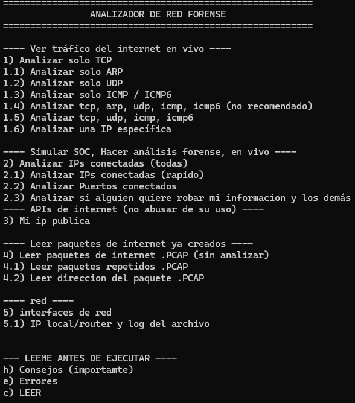
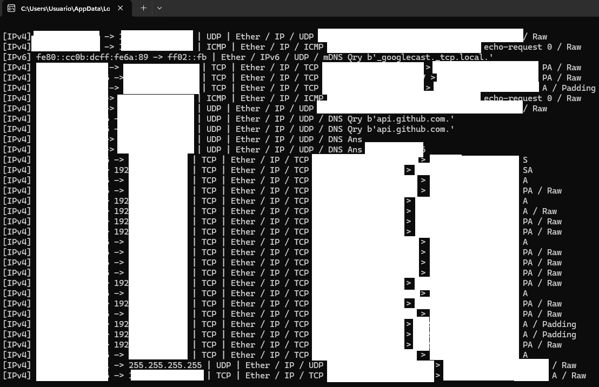
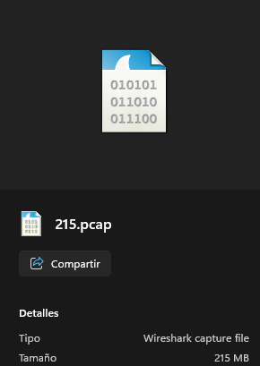

# ARF26 - Analizador de Red Forense 

Herramienta desarrollada en **Python** para el análisis y monitoreo de tráfico de red, orientada **análisis forense**, **seguridad informática**.

El proyecto combina las librerías **Scapy**, **dpkt** y **PyShark**:

- **Scapy:** Captura y análisis de tráfico en tiempo real.
- **dpkt:** Procesamiento rápido de archivos `.pcap`.
- **PyShark:** Análisis profundo mediante el motor de Wireshark/TShark.

---

# Características

## Captura de tráfico

- Captura de paquetes en tiempo real.
- Guardado de capturas en formato `.pcap`.
- Lectura de archivos `.pcap`.

---

## Estadísticas

- Conteo de paquetes por dirección IP.
- Identificación de las IP con mayor tráfico.
- Clasificación de IP:
  - Pública
  - Privada
  - Loopback
  - Multicast

---

## Análisis de protocolos

### IPv4

- Dirección origen
- Dirección destino
- Protocolo

### IPv6

- Dirección origen
- Dirección destino

### TCP

- Puertos origen y destino
- Detección de puertos inusuales

### ICMP

- Detección de tráfico ICMP

### HTTP

- Método HTTP
- Host
- URL solicitada

### DNS

- Consultas DNS
- Dominios solicitados
- Detección básica de DNS Tunneling

### TLS

- Extracción de SNI (Server Name Indication)
- Información del certificado (PyShark)

---

# Funciones de análisis

## Conteo de IP

Muestra:

- Número de paquetes enviados
- Número de paquetes recibidos
- Total
- Rol estimado:
  - Cliente
  - Servidor


---


## Detección de puertos sospechosos

Genera alertas cuando se utilizan puertos no comunes.

---

## Identificación de Hosts

Relaciona una IP con los distintos dominios observados mediante:

- Host HTTP
- SNI TLS

---

# Librerías utilizadas

- Scapy
- dpkt
- PyShark
- threading
- ipaddress
- socket
- collections
- datetime

---

# Objetivos del proyecto

Este proyecto tiene fines educativos para aprender sobre:

- Redes
- Protocolos
- Análisis Forense
- SOC
- Respuesta a Incidentes

No pretende reemplazar herramientas profesionales

---

# Capturas

Menú:


Analizando:


Analizis de 1 hora (dependiendo del trafico de la red, puede tener un diferente tamaño al mostrado a continuación):



---
---

# Instalación

## Requisitos

Python 3.11 o superior.

## Instalar dependencias

```bash
git clone https://github.com/LeonardoCoder/ARD26
cd ARD26
pip install -r requirements.txt

```

## Instalar Npcap (Windows)


Scapy requiere **Npcap**.


Durante la instalación activar:

- Install Npcap in WinPcap API-compatible Mode

Descargar desde:

https://npcap.com/

---

## Instalar Wireshark

PyShark necesita **TShark**.


Durante la instalación seleccionar:

- TShark
- Add TShark to PATH

Comprobar instalación:

```bash
tshark -v
```
Descargar desde: 
https://www.wireshark.org/download.html

---

# Ejecución

```bash
python ARF26.py
```

